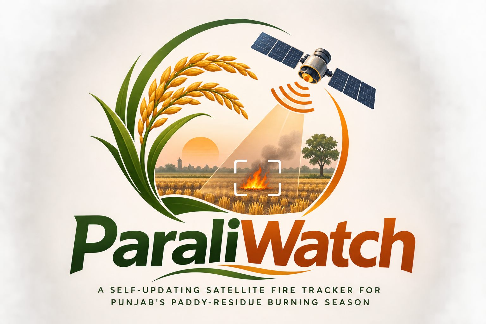
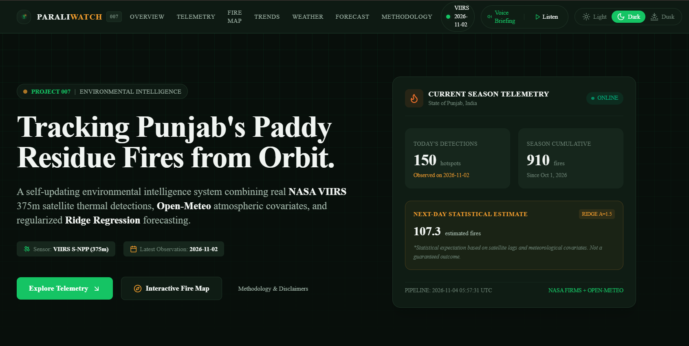
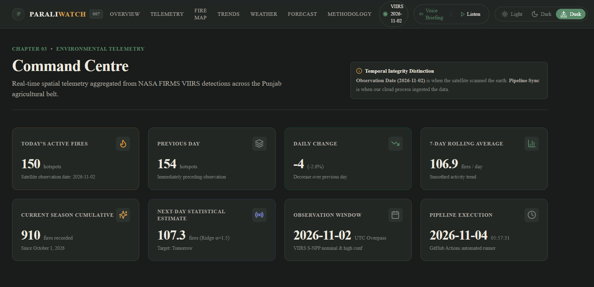
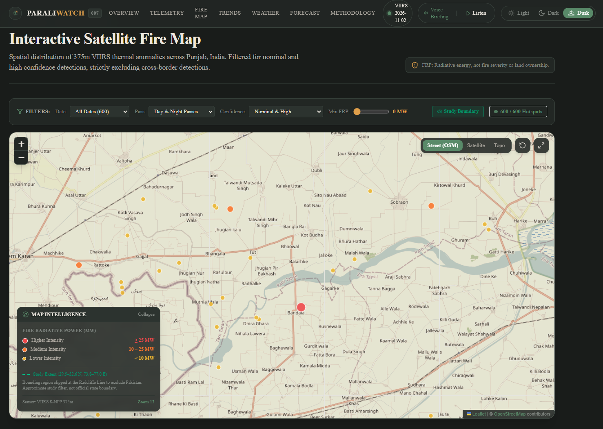
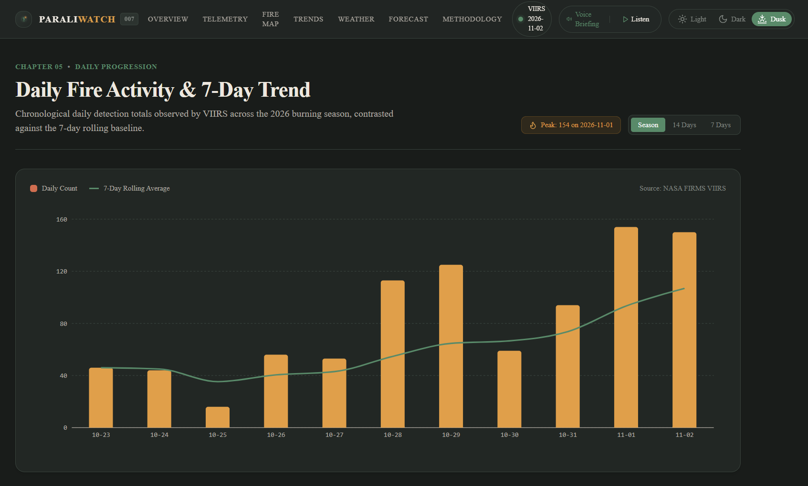
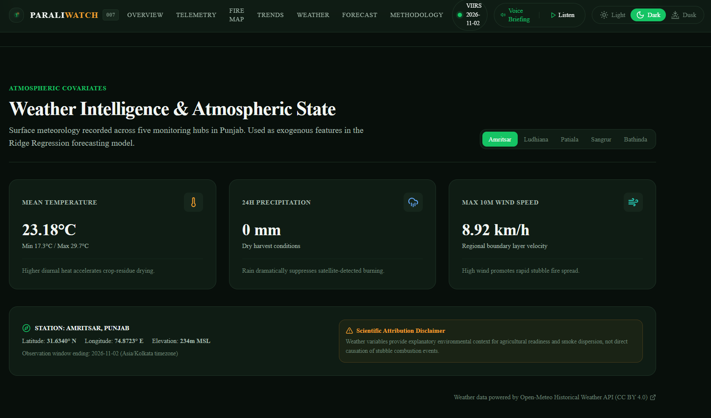
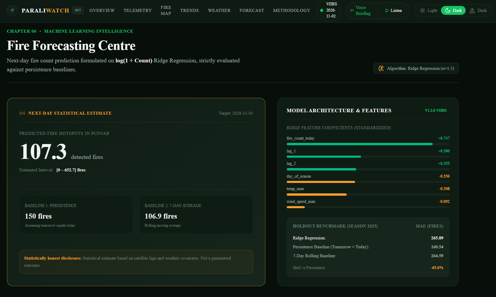
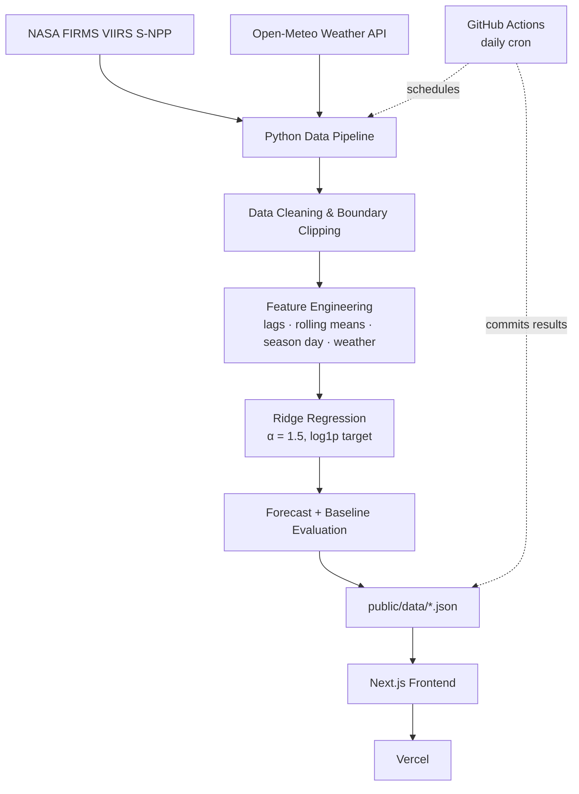

<div align="center">



# 🌾 ParaliWatch

### Tracking Punjab's Paddy-Residue Fires from Orbit

**A self-updating satellite fire tracker for Punjab's paddy-residue burning season** — built on NASA satellite data, automated by GitHub Actions, and forecast with an honestly-scored regression model.

<p>
  
  
  
  
  <br/>
  
  
  
  
  <br/>
  
  
  
  
</p>

<p>
  <a href="https://github.com/dk-khandelwal06/paraliwatch"><strong>Repository</strong></a> ·
  <a href="https://paraliwatch.vercel.app/"><strong>Live App</strong></a> ·
  <a href=""><strong>Demo Video</strong></a>
</p>

</div>

---

## 📸 Preview

<table>
<tr>
<td width="50%">

**Command Centre**


</td>
<td width="50%">

**Environmental Telemetry**


</td>
</tr>
<tr>
<td width="50%">

**Interactive Satellite Fire Map**


</td>
<td width="50%">

**Daily Activity & Seasonal Trends**


</td>
</tr>
<tr>
<td width="50%">

**Weather Intelligence**


</td>
<td width="50%">

**Forecasting Centre**


</td>
</tr>
</table>

---

## 🔥 Overview

Every autumn, paddy-residue burning is detected across Punjab as farmers clear fields between the paddy harvest and wheat sowing. Public fire maps show raw satellite hotspots, but rarely a continuously-updated daily trend, a weather-aware forecast, or an honest account of how accurate that forecast actually is.

**ParaliWatch** is an environmental intelligence platform that combines:

- 🛰️ **NASA FIRMS VIIRS S-NPP (375 m)** near-real-time thermal fire detections
- 🌦️ **Open-Meteo** historical weather observations across 5 Punjab monitoring hubs
- 🗺️ **Interactive satellite fire map** with confidence and FRP-based styling
- 📊 **Daily and multi-season fire activity analytics**
- 🤖 **Ridge regression** next-day fire-count forecasting
- 📏 **Persistence and 7-day-average baseline comparisons**, reported without cherry-picking
- ⚙️ **A fully automated daily data pipeline** (GitHub Actions → commit → redeploy)
- 🎯 **A forecast scorecard** that reconciles yesterday's prediction against what actually happened
- 🌓 **Three interface themes** — Light, Dark, and Dusk

The system is designed to run unattended through the season: a scheduled job fetches new satellite and weather data every day, re-scores the previous day's forecast, and commits the result — so the dashboard stays current with no manual intervention.

---

## 🧭 How It Works



A daily GitHub Actions job runs the Python pipeline end to end — fetch, clean, engineer features, forecast, evaluate — and commits the resulting JSON artifacts straight into `public/data/`. The Next.js frontend reads those static files directly, so the live site has no server-side dependency on the pipeline or any exposed API key.

---

## ✨ Key Features

| | Feature | Description |
|---|---|---|
| 🛰️ | **Satellite Fire Monitoring** | Near-real-time VIIRS S-NPP thermal detections, filtered to nominal/high confidence |
| 🗺️ | **Interactive Fire Map** | Leaflet map with satellite/topo base layers and FRP-based hotspot styling |
| 📈 | **Daily Fire Activity Analytics** | Day-over-day detection counts and rolling trends |
| 📊 | **Seasonal Fire Comparison** | Current season tracked against prior seasons |
| 🌦️ | **Weather Intelligence** | Temperature, precipitation, and wind across 5 Punjab hubs |
| 🔮 | **Next-Day Fire Forecasting** | Ridge regression forecast of tomorrow's detection count |
| 🎯 | **Forecast Performance Scorecard** | Every prediction is logged and scored against the actual outcome |
| ⚙️ | **Automated Daily Pipeline** | GitHub Actions fetches, processes, and commits new data every day |
| 🌓 | **Three Visual Themes** | Light (Ivory), Dark (Forest), and Dusk (Sage) |
| 🔬 | **Scientific Transparency** | Model performance and data limitations are reported as-is, including when the model underperforms |

---

## 🛠️ Technology Stack

| Layer | Technologies |
|---|---|
| **Frontend** | Next.js 14 (App Router), React 18, TypeScript, Tailwind CSS, Framer Motion |
| **Mapping & Visualization** | Leaflet / React-Leaflet, Recharts |
| **Data Processing** | Python, Pandas, NumPy |
| **Machine Learning** | scikit-learn (Ridge Regression), joblib |
| **Data Sources** | NASA FIRMS (VIIRS S-NPP), Open-Meteo Historical Weather API |
| **Automation** | GitHub Actions (scheduled + manual dispatch) |
| **Deployment** | Vercel |

---

## 🤖 Machine Learning & Forecasting

**Target:** `log1p(next_day_fire_count)`, inverted at prediction time with `expm1`.

**Features:** today's fire count; 1-, 2- and 3-day lags; 7-day rolling mean (computed without lookahead); day-of-season; mean/max temperature; total precipitation (today and lag-1); max wind speed.

**Model:** Ridge Regression, α = 1.5. Chosen for interpretability and as a deliberately simple baseline — the point of this project is the automated pipeline, not model sophistication.

**Validation:** a temporal, season-based holdout — all seasons through 2024 for training, the complete 2025 season held out for testing. A random split would leak future information into the model.

**Baselines:** persistence (ŷ<sub>t+1</sub> = y<sub>t</sub>) and a 7-day rolling average, evaluated on the same held-out season.

### Current evaluation (2025 test season, logged in `models/metrics.json`)

| Metric | Ridge Model | Persistence Baseline | 7-Day Average |
|---|---|---|---|
| MAE | 265.89 | **160.54** | 264.59 |
| RMSE | 426.10 | **253.05** | 358.03 |
| Skill vs. persistence | **−65.6%** | — | — |

**Reported honestly:** on the current test season, the Ridge model does **not** beat the persistence baseline — fire counts are spiky, and "tomorrow looks like today" is a hard baseline to beat. Comparing against simple baselines is exactly what surfaces this, rather than a lone accuracy number that sounds impressive in isolation. This is a legitimate, documented result and an open target for future iterations (e.g. gradient boosting, better lag/weather features, or a count-appropriate loss).

---

## 🌍 Data Sources & Scientific Limitations

**NASA FIRMS** — VIIRS S-NPP, 375 m resolution, near-real-time thermal anomaly detections, filtered to `nominal`/`high` confidence.

**Open-Meteo** — historical weather observations from five Punjab monitoring hubs: Amritsar, Ludhiana, Patiala, Sangrur, and Bathinda.

**Limitations, stated plainly:**
- Satellite detection depends on overpass timing; fires that start and end between passes are missed.
- Cloud cover and heavy smoke can attenuate thermal signal and suppress detections.
- A thermal anomaly indicates an active heat source — it is not legal proof of crop-residue burning and does not identify any individual farmer or landowner.
- Weather correlations shown here do not establish causation.
- Forecasts are statistical estimates, not guarantees — see the evaluation table above.

---

## 🚀 Local Setup

**Prerequisites:** Python 3.10+, Node.js 18.17+, npm.

```bash
# 1. Clone and enter the repository
git clone https://github.com/dk-khandelwal06/paraliwatch.git
cd paraliwatch

# 2. Configure environment variables
cp .env.example .env
# then edit .env and add your FIRMS_MAP_KEY (see below)

# 3. Install Python dependencies
pip install -r requirements.txt

# 4. Run the test suite
python -m unittest discover tests

# 5. Run the data + ML pipeline
python -u src/update_data.py

# 6. Install frontend dependencies
npm install

# 7. Start the development server
npm run dev
# → http://localhost:3000

# 8. Build for production
npm run build
npm start
```

---

## 🔑 Environment Variables

| Variable | Required | Purpose |
|---|---|---|
| `FIRMS_MAP_KEY` | **Required** | NASA FIRMS credential used by the Python pipeline (`src/update_data.py`) to query satellite fire data. Get a free key at the [FIRMS MAP_KEY portal](https://firms.modaps.eosdis.nasa.gov/api/map_key/). |
| `NEXT_PUBLIC_DATA_BASE_URL` | Optional | Overrides where the frontend reads JSON data from. Leave empty to read the bundled `public/data/` files; set it to point the frontend at an external/CDN copy of the data instead. |

Never commit a real `FIRMS_MAP_KEY` — only `.env.example` with placeholders is tracked. For the automated pipeline, add the key as a **repository secret** named `FIRMS_MAP_KEY` under **Settings → Secrets and variables → Actions**, and make sure **Actions → General → Workflow permissions** allows read/write so the daily job can commit updated data.

---

## ☁️ Deployment

- **Live app:** [paraliwatch.vercel.app](https://paraliwatch.vercel.app/)
- **Automation:** `.github/workflows/daily_update.yml` runs the Python pipeline daily at `02:37 UTC`, verifies the generated JSON artifacts, and commits them back to the repository — which triggers a fresh Vercel deployment.
- **To deploy your own instance:** push the repository to GitHub, import it in [Vercel](https://vercel.com) as a Next.js project (auto-detected), and optionally set `NEXT_PUBLIC_DATA_BASE_URL` if you want the frontend to read from an external data source instead of the bundled files.

---

## 📄 License

No `LICENSE` file is currently present in this repository. Until one is added, all rights are reserved by default — add a `LICENSE` file (e.g. MIT) if you intend this project to be reused or redistributed.

**Data attribution:**
- Fire detections: NASA FIRMS / MODAPS (VIIRS S-NPP 375 m)
- Weather data: Open-Meteo Historical Weather API

---

<div align="center">

### Author

**Daksh Khandelwal**

[](https://www.linkedin.com/in/daksh-khandelwal-b02748391/)
[](https://github.com/dk-khandelwal06/paraliwatch)
[](https://paraliwatch.vercel.app/)

*Project 007 — Project Atlas*

</div>
